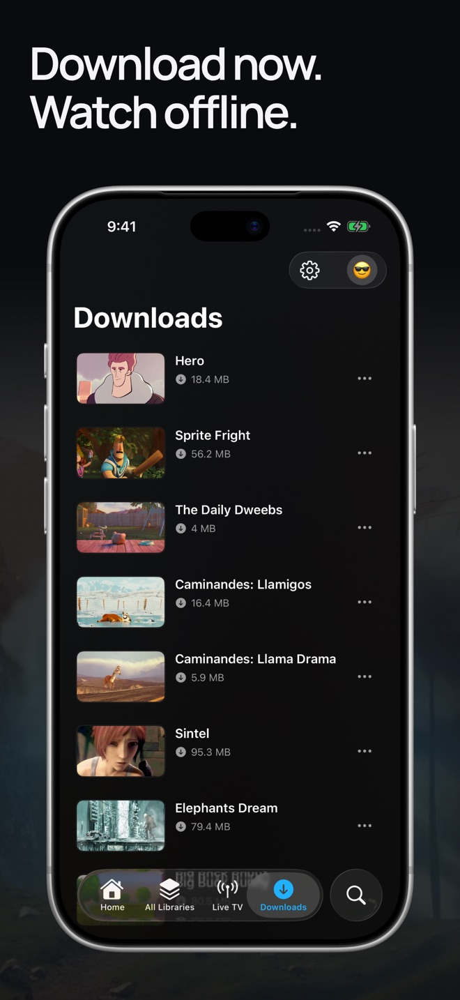
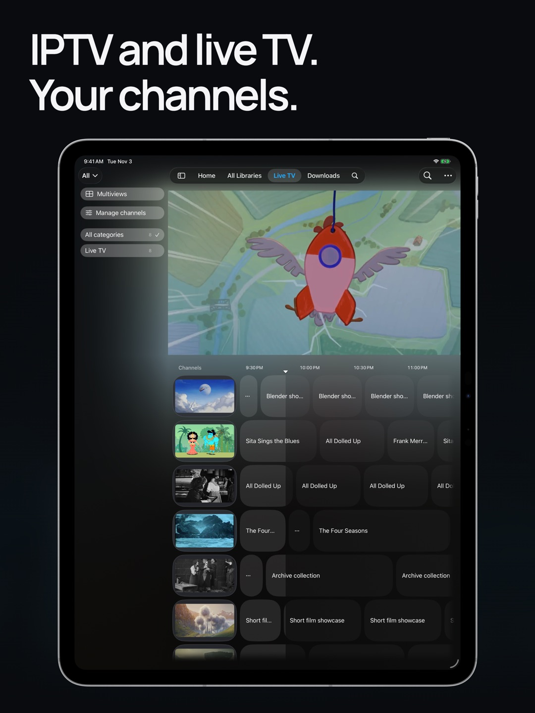

  

# Plozz — media player for Apple TV, iPhone and iPad

**Free and open source. No ads or paywalls.** Enjoy your movies, shows, music
and live TV in one app built for Apple devices. Connect **Jellyfin, Plex, Emby and Silo**,
play directly from **SMB and WebDAV shares**, and keep your setup in sync
with **iCloud**.

  

  <a href="https://plozz.app">Website</a> ·
  <a href="https://docs.plozz.app">Docs</a> ·
  <a href="https://plozz.app/discord">Discord</a> ·
  <a href="https://testflight.apple.com/join/EKfReNMu">TestFlight</a>

  

  
  &nbsp;&nbsp;
  

  Apple TV · iPhone · iPad — <a href="https://plozz.app/media-credits/">Screenshot media credits</a>

## Media servers

  
  
  
  

**All your media servers and network shares come together in one library.**
Browse and search everything in one place, without switching between sources.
You can still browse each source separately and pick up where you left off.

## Network shares

  
  
  
  
  

Play directly from your NAS or file server over **SMB, WebDAV, NFS, SFTP or FTP**.
Find artwork and details for your movies and shows, use your own artwork and metadata files,
or browse personal videos as folders. No media server required.

## Live TV and IPTV

  
  
  

Bring your M3U playlists, Xtream accounts, or Plex, Jellyfin and Emby channels
you have access to. Browse the guide, search channels, save favorites, watch up to four channels
in **Multiview**, or build scheduled channels from your own library.
Live TV is experimental; Plozz supplies no channels or IPTV subscription.

## Watch, listen and take it with you

| Feature | What you get |
| --- | --- |
| **Music on iOS, iPadOS and tvOS** | Browse albums, artists, songs and playlists from Plex, Jellyfin and Emby. Use the mini-player, queue, shuffle or repeat, and keep listening in the background. |
| **Video playback** | Pick an audio track, change playback speed and resume where you stopped. Enjoy HDR and surround sound with compatible files and equipment. |
| **Playback shortcuts** | Skip intros and credits yourself or automatically, jump between chapters where available, and choose whether the next episode starts on its own. |
| **Picture in Picture and AirPlay** | Watch while using other apps on iPhone and iPad, or send video to another screen. Availability depends on how the video plays; separately saved subtitles stay in Plozz. |
| **Subtitles** | Show two tracks at once and adjust their font, size, color, background and position. Search for subtitles when your server supports it. |
| **Versions and quality** | Switch between files or editions on the same server without leaving the player. Choose streaming quality on iPhone and iPad. |
| **Offline downloads** | Save movies and episodes on iPhone and iPad, choose their quality, and browse saved artwork and details without a connection. |
| **Library details** | Explore cast, ratings, collections, extras and trailers, depending on what your server provides. |
| **Watchlists and history** | Keep a watchlist across services, mark episodes or seasons watched, and optionally sync watch history across servers. |

### Supported formats

| Type | Formats |
| --- | --- |
| **Video files** | MKV, MP4/M4V, MOV, WebM, AVI, MPEG-TS (TS, M2TS, MTS, M2T), MPEG-PS (MPG, VOB), 3GP/3G2, OGG/OGV, ASF/WMV, FLV, RealMedia (RM/RMVB). Decrypted DVD/Blu-ray ISO images and Blu-ray folders. |
| **Video codecs** | H.264/AVC, H.265/HEVC, AV1, VP9, VP8, MPEG-2, MPEG-4 Part 2 (Xvid/DivX), VC-1, WMV 1–3, MS-MPEG4 v1–3, QuickTime RLE, FLV1 (Sorenson Spark), VP6, RealVideo 1–4, H.263, Theora. |
| **Audio codecs** | AAC, HE-AAC/v2, AC-3 (Dolby Digital), E-AC-3 (Dolby Digital Plus, including JOC), TrueHD, MLP, DTS, DTS-HD MA, FLAC, ALAC, MP3, MP2, PCM/LPCM (including G.711), Opus, Vorbis, WMA (Standard, Pro, Lossless, Voice), Nellymoser, ADPCM-SWF, Speex, RealAudio (Cook, ATRAC3, Sipro, Lossless, 14.4/28.8), AMR-NB/WB. |
| **HDR** | HDR10, HDR10+ and HLG. |
| **Dolby Vision** | Profiles 5, 8.1, 8.4 and AV1 10.1 on compatible devices and displays. AV1 profiles 10.0 and 10.4 also need built-in AV1 support in your device's chip. |

Profile 7 (MEL/FEL) plays as HDR10; profiles 8.2 and AV1 10.2 play as SDR.
Without that chip support, AV1 10.4 plays as HLG instead of Dolby Vision,
and 10.0 won't play correctly.

Your file, device, display and speakers all affect playback. TrueHD and DTS-HD MA
play as regular surround audio, not height channels or bitstream passthrough.
Some formats need more processing power; server conversion can change picture
and sound quality. [Format details and limits](https://plozz.app/formats/).

## Your setup, on every device

  

**iCloud sync across Apple TV, iPhone and iPad** keeps profiles, settings,
server connections, watchlists and supported Live TV settings together. Add
another device with nearby-device setup, a QR code or a pairing code.

Your media files and downloads don't move between devices. You may need to
sign in again, depending on the service; Silo needs approval on each device.
[Sync controls and limits](https://docs.plozz.app/profiles-and-sync/).

## Trackers and requests

  
  
  
  
  
  

Connect **Trakt, Simkl and WeTrakr** for movies and TV, **AniList and
MyAnimeList** for anime, and **Last.fm** to log the music you play.
Tracking and watchlist features vary by service and account. Connect only
the services you want, separately for each profile.

  

**Request missing movies and shows with Seerr**, including individual seasons,
without leaving Plozz.

## Make it yours

- **Profiles:** give everyone their own library choices, playback preferences
  and subtitle settings. Server accounts still control access and watch history.
- **Viewing controls:** Kids profiles, parental PINs, profile locks and
  spoiler protection.
- **Appearance:** choose light, dark or Pure Black, and make room for more
  posters or bigger artwork. Arrange navigation your way.
- **Circadian mode:** automatically dim and warm Plozz, including video
  playback, from sunset to sunrise or on your own schedule.
- **Apple TV Top Shelf:** Continue Watching and Recently Added on the Home Screen.

## Diagnostics, with your permission

  

**Optional diagnostics powered by Sentry** help us troubleshoot crashes,
freezes and playback problems. Sharing is **off unless you turn it on** in
Help &amp; Diagnostics. Reports can include app, device and filtered technical
details; messages you send are included as written. No advertising or usage analytics.
[Privacy and diagnostic controls](https://plozz.app/privacy/#diagnostics).

## Get started

Install **[Plozz Player](https://apps.apple.com/app/plozz-player/id6782668147)**
on tvOS, iOS or iPadOS 18 or later, then connect your server, network share or
IPTV source. **Plozz supplies no movies, music, channels or subscriptions.**
Features vary by device and service. Your server's access rules and any
subscriptions it requires still apply.

This README covers what's implemented in the code. App Store and TestFlight
releases may be behind; mobile music is enabled for development/TestFlight
builds, but isn't in the App Store version yet.

[Explore features](https://plozz.app/features/) ·
[Supported formats](https://plozz.app/formats/) ·
[Docs](https://docs.plozz.app)

## Help and contribute

[Report a bug or request a feature](https://github.com/brandomoore/Plozz/issues/new/choose) ·
[Build and contribute](.github/CONTRIBUTING.md) ·
[Release notes](https://github.com/brandomoore/Plozz/releases)

Keep passwords, tokens and private server URLs out of public issues.
If Plozz is useful to you, [donations are welcome](https://github.com/sponsors/brandomoore).
It's free either way.

## License and credits

[GPL-3.0](LICENSE) with an [App Store Exception](LICENSE-EXCEPTION.md).
© 2026 Brandon Moore. See [NOTICE.md](NOTICE.md) for bundled software notices.

Service acknowledgments and media attribution

Plozz is an unofficial client and is not affiliated with, endorsed, or certified
by any of the services below.

- **AetherEngine** — on-device playback engine by Vincent Herbst,
  LGPL-3.0 with an App Store exception.
  [superuser404notfound/AetherEngine](https://github.com/superuser404notfound/AetherEngine).
  Its bundled FFmpeg is a decode-only, LGPL-3.0 build (see [NOTICE.md](NOTICE.md)).
- **The Movie Database (TMDB)** — some artwork and metadata is provided by the
  TMDB API. This product uses the TMDB API but is not endorsed or certified by
  TMDB. TMDB's marks and logos are trademarks of TMDB.

  

- **[TheTVDB](https://thetvdb.com)** — some metadata and artwork is provided by
  TheTVDB. Please consider adding missing information or subscribing at
  [thetvdb.com](https://thetvdb.com). This product uses the TheTVDB API but is
  not endorsed or certified by TheTVDB.

  

- **OMDb API** — optional IMDb ratings enrichment (requires your own OMDb key).
- **AniList** — keyless community scores for anime titles.
- **Plex, Jellyfin, Emby and Silo** — compatible media servers. Names and logos
  belong to their respective owners.
- **Screenshot artwork** — [creators, licenses and adaptations](https://plozz.app/media-credits/);
  [image provenance](docs/screenshots.md). Demonstration media is not bundled
  with Plozz and is not covered by the app's license.
- **Integration badges** — [logo sources and icon licenses](docs/assets/integrations/provenance.json).
  Logos identify compatible services, not sponsorship or endorsement.
  Network and playlist formats use generic storage and TV symbols.

<!-- app-family:start -->
<!-- Generated by https://github.com/brandomoore/brando — edit apps.json there, not this block. -->

---

<b>More open source</b>

  <a href="https://github.com/brandomoore/Hozz" title="Hozz — Apple Health, exported to storage you own"><picture><source media="(prefers-color-scheme: dark)" srcset="https://raw.githubusercontent.com/brandomoore/brando/main/logos/lockups/hozz-dark.svg" /></picture></a>
  &nbsp;&nbsp;&nbsp;&nbsp;&nbsp;&nbsp;
  <a href="https://github.com/brandomoore/Mozz" title="Mozz — Your music, wherever it lives"><picture><source media="(prefers-color-scheme: dark)" srcset="https://raw.githubusercontent.com/brandomoore/brando/main/logos/lockups/mozz-dark.svg" /></picture></a>
  &nbsp;&nbsp;&nbsp;&nbsp;&nbsp;&nbsp;
  <a href="https://github.com/brandomoore/Plozz" title="Plozz — Movies &amp; TV on Apple TV, iPhone &amp; iPad"><picture><source media="(prefers-color-scheme: dark)" srcset="https://raw.githubusercontent.com/brandomoore/brando/main/logos/lockups/plozz-dark.svg" /></picture></a>
  &nbsp;&nbsp;&nbsp;&nbsp;&nbsp;&nbsp;
  <a href="https://github.com/brandomoore/strozz" title="Strozz — Twitch on Apple TV, with real emotes"><picture><source media="(prefers-color-scheme: dark)" srcset="https://raw.githubusercontent.com/brandomoore/brando/main/logos/lockups/strozz-dark.svg" /></picture></a>

  <a href="https://brando.page">
    <picture>
      <source media="(prefers-color-scheme: dark)" srcset="https://raw.githubusercontent.com/brandomoore/brando/main/logos/brando-white.svg" />
      
    </picture>
  </a>

<!-- app-family:end -->
