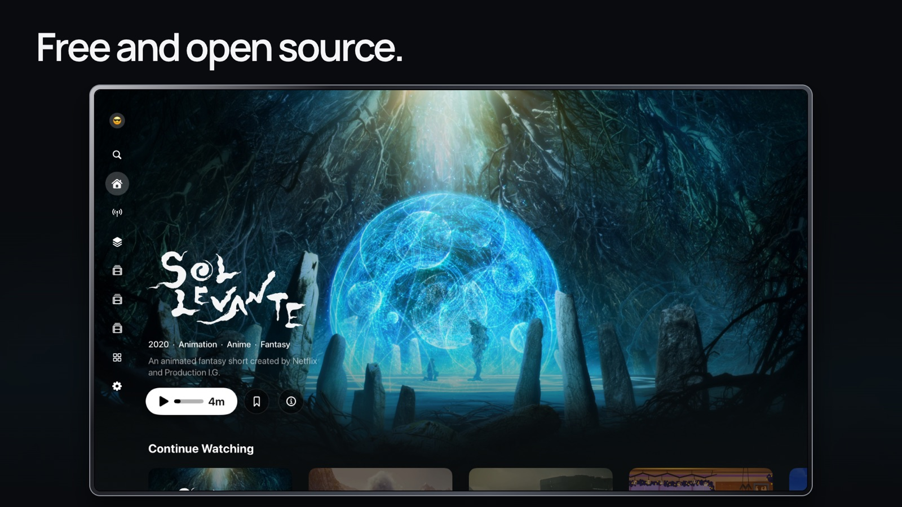
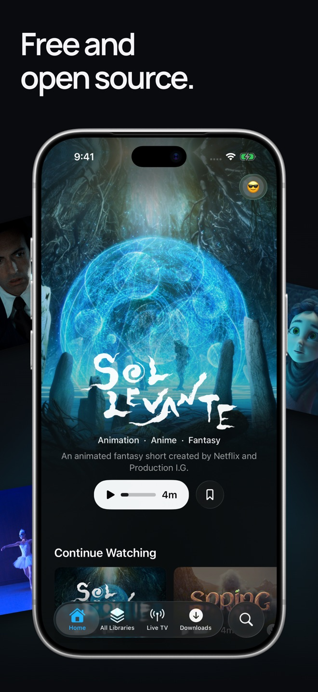
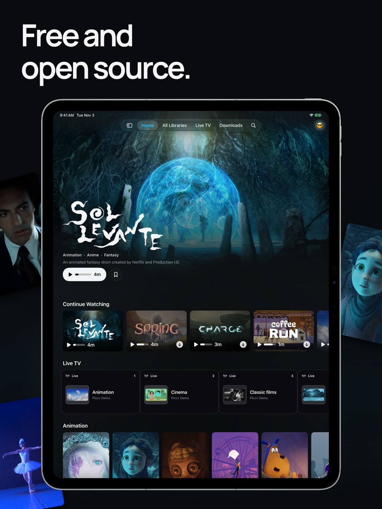

  

# Plozz — media player for Apple TV, iPhone and iPad

**Free and open source. No ads or paywalls.** Movies, TV, music and live
channels in one native Apple app. Connect **Jellyfin, Plex, Emby and Silo**,
browse network shares, and keep your setup in sync with **iCloud**.

  

  <a href="https://plozz.app">Website</a> ·
  <a href="https://docs.plozz.app">User guide</a> ·
  <a href="https://plozz.app/discord">Discord</a> ·
  <a href="https://testflight.apple.com/join/EKfReNMu">TestFlight</a>

## On every screen

  

  
  &nbsp;&nbsp;
  

  Apple TV · iPhone · iPad — <a href="https://plozz.app/media-credits/">Screenshot media credits</a>

## Your media, together

### Media servers

  
  
  
  

Connect multiple servers and bring their libraries together, or browse each
one separately. Search across your collection, filter and sort, jump to a
letter, and pick up from Continue Watching. Silo uses its native API.

### Network shares

  
  
  
  
  

Play directly from your NAS or file server over **SMB, WebDAV, NFS, SFTP or FTP**.
Match movies and shows with artwork and metadata, use local sidecar files,
or browse personal videos as folders. No media server required.

### Live TV and IPTV

  
  
  

Use your playlists, Xtream accounts, or authorized Plex, Jellyfin and Emby
channels. Browse and search the guide, save favorites, watch up to four channels
in **Multiview**, or build scheduled channels from your own library.
Live TV is experimental; Plozz supplies no channels or IPTV subscription.

## Watch, listen and take it with you

| Feature | What you get |
| --- | --- |
| **Music on iOS, iPadOS and tvOS** | Albums, artists, tracks and playlists from Plex, Jellyfin and Emby, with a mini-player, queue, shuffle, repeat and background audio. |
| **Video playback** | HDR, HEVC and AV1 support, audio-track selection, playback speed, resume, and multichannel audio with compatible streams and equipment. |
| **Subtitles** | Two tracks at once; adjustable font, size, color, background and position; subtitle search through supported servers. |
| **Versions and quality** | Switch files or editions on the active server without leaving the player. Set streaming-quality limits on iPhone and iPad. |
| **Offline downloads** | Save movies and episodes on iPhone and iPad, choose download quality, and browse saved artwork and metadata offline. |
| **Library details** | Artwork, cast, ratings, collections, extras and trailers, with availability depending on your provider. |
| **Watchlists and history** | Keep a watchlist across connected services, mark episodes or seasons watched, and optionally sync watch history across servers. |

## Your setup, on every device

  

**iCloud sync across Apple TV, iPhone and iPad** keeps profiles, settings,
server details, watchlists and supported Live TV setup together. Nearby-device,
QR and pairing-code setup help you add another device.

Media files and offline downloads stay on their devices. Sign-in transfer
depends on the service and platform; Silo requires approval on each device.
[Sync controls and limits](https://docs.plozz.app/profiles-and-sync/).

## Keep your trackers in sync

  
  
  
  
  
  

Connect **Trakt, Simkl and WeTrakr** for movies and TV, **AniList and
MyAnimeList** for anime, and **Last.fm** for music scrobbling. Tracking and
watchlist capabilities follow each service's supported media and account.
Connections are optional and profile-scoped.

  

**Request missing movies and shows with Seerr**, including individual seasons,
without leaving Plozz.

## Make it yours

- **Profiles:** separate library choices, playback preferences and subtitle
  settings. Server users still control access and watch history.
- **Appearance:** light, dark and Pure Black themes, adjustable row density,
  hero artwork and navigation layout.
- **Circadian mode:** warm and dim the interface on your schedule.

## Diagnostics, with your permission

  

**Optional diagnostics powered by Sentry** help investigate crashes, hangs and
playback problems. Sharing is **off until you opt in**, and you can change it
in Help &amp; Diagnostics. Reports can include app, device and filtered technical
details; messages you submit are sent as written. No advertising or usage analytics.
[Privacy and diagnostic controls](https://plozz.app/privacy/#diagnostics).

[Explore features](https://plozz.app/features/) ·
[Supported formats](https://plozz.app/formats/) ·
[Setup guides](https://docs.plozz.app)

## Get started

Install **[Plozz Player](https://apps.apple.com/app/plozz-player/id6782668147)**
on tvOS, iOS or iPadOS 18 or later, then connect your server, network share or
IPTV source. **Plozz supplies no movies, music, channels or subscriptions.**
Features vary by device and provider; server permissions and provider
subscription requirements still apply.

This README describes the current source. App Store and TestFlight builds may
lag behind; mobile music is currently enabled in development/TestFlight builds,
not App Store builds.

## Help and contribute

[Report a bug or request a feature](https://github.com/brandomoore/Plozz/issues/new/choose) ·
[Build and contribute](.github/CONTRIBUTING.md) ·
[Release notes](https://github.com/brandomoore/Plozz/releases)

Keep passwords, tokens and private server URLs out of public issues.
If Plozz is useful to you, [donations are welcome](https://github.com/sponsors/brandomoore).
It's free either way.

## License and credits

[GPL-3.0](LICENSE) with an [App Store Exception](LICENSE-EXCEPTION.md).
© 2026 Brandon Moore. See [NOTICE.md](NOTICE.md) for bundled software notices.

Service acknowledgments and media attribution

Plozz is an unofficial client and is not affiliated with, endorsed, or certified
by any of the services below.

- **AetherEngine** — on-device playback engine by Vincent Herbst,
  LGPL-3.0 with an App Store exception.
  [superuser404notfound/AetherEngine](https://github.com/superuser404notfound/AetherEngine).
  Its bundled FFmpeg is a decode-only, LGPL-3.0 build (see [NOTICE.md](NOTICE.md)).
- **The Movie Database (TMDB)** — some artwork and metadata is provided by the
  TMDB API. This product uses the TMDB API but is not endorsed or certified by
  TMDB. TMDB's marks and logos are trademarks of TMDB.

  

- **[TheTVDB](https://thetvdb.com)** — some metadata and artwork is provided by
  TheTVDB. Please consider adding missing information or subscribing at
  [thetvdb.com](https://thetvdb.com). This product uses the TheTVDB API but is
  not endorsed or certified by TheTVDB.

  

- **OMDb API** — optional IMDb ratings enrichment (requires your own OMDb key).
- **AniList** — keyless community scores for anime titles.
- **Plex, Jellyfin, Emby and Silo** — compatible media servers. Names and logos
  belong to their respective owners.
- **Screenshot artwork** — [creators, licenses and adaptations](https://plozz.app/media-credits/);
  [image provenance](docs/screenshots.md). Demonstration media is not bundled
  with Plozz and is not covered by the app's license.
- **Integration badges** — [logo sources and icon licenses](docs/assets/integrations/provenance.json).
  Logos identify compatible services, not sponsorship or endorsement.
  Network and playlist formats use generic storage and TV symbols.

<!-- app-family:start -->
<!-- Generated by https://github.com/brandomoore/brando — edit apps.json there, not this block. -->

---

<b>More open source</b>

  <a href="https://github.com/brandomoore/Hozz" title="Hozz — Apple Health, exported to storage you own"><picture><source media="(prefers-color-scheme: dark)" srcset="https://raw.githubusercontent.com/brandomoore/brando/main/logos/lockups/hozz-dark.svg" /></picture></a>
  &nbsp;&nbsp;&nbsp;&nbsp;&nbsp;&nbsp;
  <a href="https://github.com/brandomoore/Mozz" title="Mozz — Your music, wherever it lives"><picture><source media="(prefers-color-scheme: dark)" srcset="https://raw.githubusercontent.com/brandomoore/brando/main/logos/lockups/mozz-dark.svg" /></picture></a>
  &nbsp;&nbsp;&nbsp;&nbsp;&nbsp;&nbsp;
  <a href="https://github.com/brandomoore/Plozz" title="Plozz — Movies &amp; TV on Apple TV, iPhone &amp; iPad"><picture><source media="(prefers-color-scheme: dark)" srcset="https://raw.githubusercontent.com/brandomoore/brando/main/logos/lockups/plozz-dark.svg" /></picture></a>
  &nbsp;&nbsp;&nbsp;&nbsp;&nbsp;&nbsp;
  <a href="https://github.com/brandomoore/strozz" title="Strozz — Twitch on Apple TV, with real emotes"><picture><source media="(prefers-color-scheme: dark)" srcset="https://raw.githubusercontent.com/brandomoore/brando/main/logos/lockups/strozz-dark.svg" /></picture></a>

  <a href="https://brando.page">
    <picture>
      <source media="(prefers-color-scheme: dark)" srcset="https://raw.githubusercontent.com/brandomoore/brando/main/logos/brando-white.svg" />
      
    </picture>
  </a>

<!-- app-family:end -->
